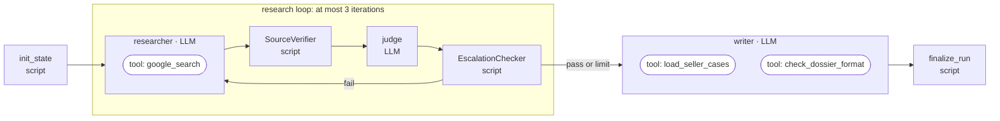
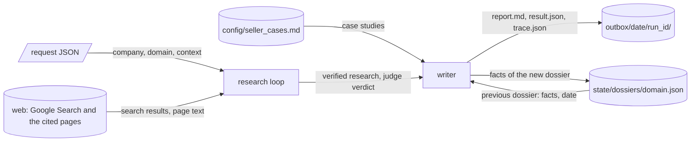
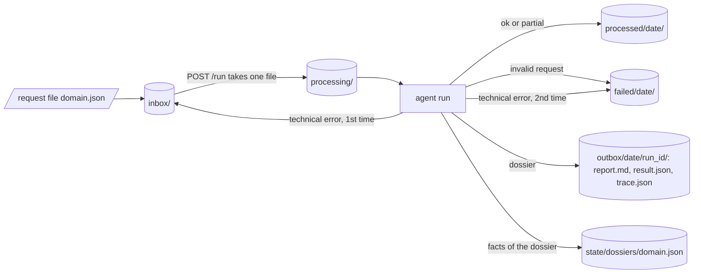

# Prospect Dossier: report

UCU GenAI, Assignment 1. How to run the system: [README](../README.md). How it was built,
step by step: [CRISP-DM log](crisp-dm.md). Full evaluation tables:
[eval/results/summary.md](../eval/results/summary.md).

## 1. Problem and scope

Before a first call, a sales person researches the target company by hand. Prospect Dossier
takes a company name and domain and returns a dossier of about two pages that the sales
person can trust, because every fact in it points to a page that really says it.

**In scope (business logic):**

- **Input:** `{"company": "...", "domain": "...", "context": "optional"}`.
- **Output:** a Markdown dossier with Snapshot, Recent news, Tech signals, Key people,
  Likely pains, Metacortex angle and What changed, plus `result.json` (status, counts,
  costs) and `trace.json` (each research iteration).
- **Rules:** every fact has a URL and a quote that is on that page; no data means
  `[Pending]`, never an invented fact; news at most 90 days old; for people only name and
  public role; a company that does not exist gets an honest dossier of `[Pending]`;
  a repeated request for the same company reports what changed since the last dossier.
- **The seller:** Metacortex, the fictional software company from "The Matrix", with six
  invented case studies; the "angle" section suggests how Metacortex could help and cites
  1-2 of them.
- **Limits:** at most $0.40 and 9 minutes per dossier, at most 3 research iterations and
  15 searches.

**Out of scope:** paid company databases and LinkedIn, sending anything to the company,
real case studies of a real seller.

## 2. Data

The agent does not use a prepared data set. Every dossier is built from **live web search**
(Google Search through Gemini) and from the **pages the search cites**, which a script
downloads to check the quotes. The seller's case studies are **synthetic** (six invented
entries in `demo-data/config/seller_cases.md`).

The evaluation data is **synthetic or labelled by hand** (details in
[crisp-dm.md, section 3](crisp-dm.md#3-data-preparation)): 16 hand-written requests for the
parser; 151 SourceVerifier cases generated from 20 real pages of our runs (the label is known
by construction) plus 12 real facts labelled by hand; 13 corrupted versions of one correct
research text for the judge; 10 hand-labelled company profiles for the case selection;
6 recorded end-to-end runs. All of it is small and labelled on our side, which limits how far
the scores can be trusted (section 4).

What we learned about the web data shaped the design: search returns redirect links instead
of pages; some sites answer a script with a bot-protection page; pages change between runs;
news is often missing or undated; third-party pages are cited as sources (crisp-dm.md, section 2).

## 3. Architecture

### 3.1 Components

The steps of one run, in order, with the tools each LLM agent uses (dotted). The demo app
draws the same graph live, with each node's state on hover.

In ADK terms: the root is a `SequentialAgent` (`dossier_pipeline`) with two sub-agents, the
`LoopAgent` `research_loop` (researcher, SourceVerifier, judge, EscalationChecker) and the
`writer`; `init_state` and `finalize_run` are its before and after callbacks, and
`prepare_writer` is the writer's before callback.

| Component | Kind | Purpose | Reads | Writes |
|---|---|---|---|---|
| `init_state` | script (callback) | check the request, load the seller's case studies and the previous dossier | the user message, `config/seller_cases.md`, `state/dossiers/<domain>.json` | `company`, `domain`, `seller`, `seller_cases`, `prior_knowledge`, `previous_dossier_date` |
| `researcher` | LLM: Gemini + Google Search | find facts on 5 topics, each with URL and verbatim quote | `request`, previous `research`, `judge_feedback` | `research` |
| `SourceVerifier` | script | open every cited page, check that the quote and the date are on it | `research`, the web pages | `verification` (report for the judge), `verification_counts`, `resolved_urls`, `trace` |
| `judge` | LLM: Gemini, JSON output | decide pass or fail and list every problem | `research`, `verification` | `judge_feedback` |
| `EscalationChecker` | script | count iterations; stop the loop on pass, or at 15 searches / 70% of the budget | `judge_feedback`, `usage` | `iterations`, escalate |
| `prepare_writer` | script (callback) | pick the news dated after the previous dossier | `research`, `previous_dossier_date` | `new_news` |
| `writer` | LLM: Gemini + 2 tools | write the dossier from the verified research | `research`, `judge_feedback`, `prior_knowledge`, `new_news` | `dossier_md` |
| `load_seller_cases` | tool (script) | rank the case studies for the company, return at most 5 | industry and keywords from the writer | candidates; their URLs become allowed |
| `check_dossier_format` | tool (script) | check sections, URLs, length; every URL must come from the research or the cases | the draft | success + message |
| `finalize_run` | script (callback) | final check, real URLs, memory, output files | `dossier_md`, state | `outbox/<date>/<run_id>/`, `state/dossiers/<domain>.json` |

**Model calls:** three LLM agents on `gemini-3.8-flash` (Gemini API), 5-8 calls per run;
the judge runs with thinking level `low`. **External tools:** Google Search (grounding, inside
the researcher's model call), HTTP downloads of the cited pages (SourceVerifier), local files.
**Hard stops:** callbacks before and after every model call stop a run at 50 calls, $0.40 or
540 s; the dossier is then written from the last draft with status `partial`.

### 3.2 Data flow

What goes into the agent, what passes between its two parts, and what comes out
(`init_state` and `finalize_run` read and write the files; see 3.1 for the steps).

### 3.3 Running as a service

The same agent runs behind a FastAPI service in Docker. A request is a file in `inbox/`;
each `POST /run` takes one file, moves it to `processing/` (so no other call takes it), runs
the agent, and moves the file on according to the result:

A file left in `processing/` for more than 12 minutes (a run that was cut off) counts as a
failed attempt.

### 3.4 One request, step by step

The demo video walks through one recorded run in the demo app: Supabase, where the judge
sends the research back once (6 claims whose quotes were not on the page) and passes it at
the second iteration; then the writer picks a case study and checks the format.

## 4. Evaluation

**Approach.** Every component is measured separately, so a weak score points to the part that
causes it. Six end-to-end runs were recorded once ($0.787: four real companies of different
industries, a repeated request with memory, a fictional company); after that every metric is
recomputed from the recorded files for free (`python -m eval.eval_components`). The judge has
its own eval on 13 corrupted research texts ($0.06). We did not use the built-in `adk eval`
metrics: they compare the answer with a fixed text, and web research differs on every run.
515 offline tests check the scripts on top of this.

| Component | What we measure, and why | Result |
|---|---|---|
| request parsing | accuracy on 16 valid and invalid requests: a wrong domain becomes a wrong file path | 16/16 |
| researcher | **grounded rate** (supported / checkable facts) at the 1st and the final iteration: its job is facts whose quote is really on the page; misquote and dead-link rate; section coverage; news freshness; invented facts for the fictional company | grounded 0.885 → 1.0; misquotes 0; coverage 0.96; news in 4/5 runs, all within 90 days; fictional: 0 facts |
| SourceVerifier | a classifier, so **precision, recall, F1** of "supported" (a false "supported" lets an invented fact through) and of the weak-support flag, on cases with a known label; date check accuracy | supported P = R = 1.0; weak flag: P 1.0, R 0.54 (synthetic), P 0.4, R 0.67 (12 real facts); dates 1.0 |
| judge | accuracy, **precision and recall of "fail"** on corrupted research, plus benign changes that must still pass (a too strict judge is also wrong) | 13/13 |
| writer | format validity; **faithfulness** (a fact bullet must match a supported research fact with the same URL); URL provenance; honesty (a section has content only if the research had a supported fact); case studies: precision and recall against hand labels | format 6/6, first try 6/6; faithful 0.976; URLs 1.0; honesty 1.0; cases P 0.6, R 0.33 |
| load_seller_cases | **hit@1 and MRR**: the tool returns a ranked list and the writer looks at the top | 1.0 (0.8 before the fix of 2026-11-16) |
| memory | first request: What changed `[Pending]`; repeated request: previous dossier loaded and changes reported; memory saved | 1.0 on all three |
| whole pipeline | status, iterations, cost and time against the limits | 5 ok, 1 partial; mean $0.131 (max $0.209), mean 201 s (max 311 s) |

**Why the high scores are high.**
- Format, URL provenance, request parsing and the "supported" check are scripts with tests:
  they are exact by construction, so 1.0 is expected; the eval guards against regressions.
- The researcher reaches a grounded rate of 1.0 only after the loop: the 1st iteration is
  0.885, and the judge sent the research back in 3 of 6 runs. The loop does its job.
- The judge's 13/13 is on synthetic corruptions. In a real run (2026-11-11) it passed a claim
  that said more than its quote, and the same kind of error built into the eval was caught;
  so the score is an upper bound.

**Why the low scores are low, and how to improve them.**
- **Weak-support flag** (SourceVerifier): it compares the key words of the claim with the
  quote. It misses a subtle overstatement that adds one word such as "the largest" (0/20) and
  flags correct paraphrases (precision 0.4 on real facts). Improve: an entailment check (a
  small NLI model or one LLM call) only for supported facts; calibrate the threshold on the
  labelled cases; look for numbers near the quote, not on the whole page.
- **Case studies in the dossier** (writer, recall 0.33): the writer cites a case only when a
  fact supports the link, and does not always take the top candidate (Supabase: cs-02 ranked
  first, cs-01 cited; Rozetka: none). Part of it was the ranking itself, fixed on 2026-11-16
  (Doctolib's relevant case was not even in the top 5); whether the writer now cites better
  cases needs a paid re-run.
- **Partial run** (PostHog): 21 searches in one iteration went over the limit of 15. All
  searches happen inside one model call, so the limit can only stop the next iteration.
- **Evidence is small:** 6 runs, one repeated request, labels made on our side. The
  case-selection profiles were written by whoever knew the gaps, so their 1.0 is partly by
  construction; the independent evidence is the Doctolib run.

## 5. CRISP-DM

The project followed CRISP-DM in short cycles: build, measure, go back to the phase where the
problem came from. The [CRISP-DM log](crisp-dm.md) describes each phase and 12 dated
iterations; three examples:

- **Evaluation → Data understanding:** the judge eval started failing a correct research
  because the live page had changed (team of 10 → 11): the eval depends on live pages.
- **Evaluation → Modeling:** an LLM formatter changed URLs in 3 of 4 links, so it was replaced
  by a script and Pydantic validation.
- **Evaluation → Modeling, with a step back:** the component eval found that the case
  selection missed the right case for Doctolib; industry synonyms raised hit@1 from 0.8 to 1.0,
  and a second idea (matching the case title) was dropped because the eval showed a regression.

## 6. Working with the AI assistant

The project was built with Claude Code. Its setup is part of the repository:

- **`CLAUDE.md`**: the project context and the working rules: code only after the design is
  agreed; paid runs only with permission; secrets never shown; a list of facts about ADK that
  were checked in its source code (so the assistant does not invent API behaviour); the known
  weaknesses; and section 1.1, the instructions to follow CRISP-DM (name the phase of each
  task, one change at a time, run the eval after every change, never accept a regression
  silently, log each kept iteration).
- **Skills** (`.claude/skills/`), the project's repeated procedures written as instructions
  for the assistant: `run-eval` (recompute the eval and compare with the previous result, with
  a script), `crisp-dm-iteration` (log an iteration), `verify-adk` (check ADK behaviour in the
  installed source), `write-tests` (how tests are written here: offline, fake ADK contexts,
  regression tests for eval findings).

What worked: the assistant checked ADK behaviour in its source code and confirmed it with runs
that cost nothing (all model calls blocked by the hard stop); the eval comparison caught its
own regression (the case-title idea). What needed the human: the assistant once claimed a
requirement was not in the assignment, and the user corrected it from the PDF; labels and
scope decisions stayed with the user.

## 7. Limitations and next steps

- A repeated dossier is a new snapshot: facts the new search does not find again drop out of
  the dossier and the memory. Next: re-check the previous facts on their pages and carry over
  the ones still there.
- Sites behind bot protection cannot be checked, and the judge then fails the research.
- The date check asks whether the date is on the page, not whether it is the date of that news item.
- Third-party pages are accepted as sources; pains may rest on old posts.
- The cost hard stop is checked before a call, so one call can go over the limit.
- Evaluation: freeze page snapshots for the judge eval; add real failure cases to it;
  re-run the end-to-end runs after the case-selection fix.
